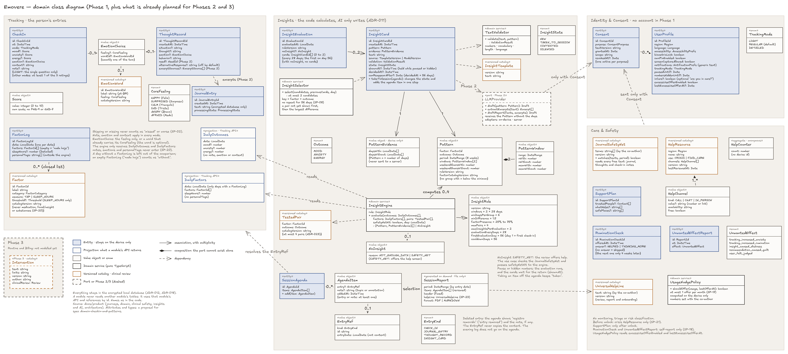

# Domain class diagram

> Part of the Emovere product specification. Status: draft. Emovere is a self-knowledge journal that complements, and never replaces, professional care. It is not a medical device.

The app's domain model: the entities in [Domain model](../product/04-domain-model.md), grouped into its modules, with the insight-engine services from [Insights and AI](../product/08-insights-and-ai.md). Three columns: Tracking; Insights; Identity & Consent with Care & Safety. The `.png` is for viewing and the `.excalidraw` file for editing in [Excalidraw](https://excalidraw.com). The domain starts in spec `domain-checkin-and-patterns` (see the [Spec plan](../roadmap/spec-plan.md)); the use cases are in [Use-case diagrams](use-cases.md).

**How to read it:** a blue box is an entity (it stays on the device only); a white box with a blue border is a projection (what one module's API returns to another); a white box with a grey border is a value object or an enum; a black border is a domain service (pure TypeScript); an amber border is a versioned catalog, which only changes with clinical review; dashed means a port or Phase 2/3. A solid arrow is an association, with multiplicity; a diamond is a composition; a dashed arrow is a dependency.

## What is fact and what is proposal

- **Fact:** the entities, the modules and the rules written in the diagram's notes come from the product specification (`docs/product`) and the psychological safety criteria (SP).
- **Fact:** the `InsightRule` numbers are those of ADR-022 and SP-06 to SP-08. The specification itself says they are proposals to calibrate with the clinical co-author (see [Clinical safety](../product/07-clinical-safety.md) and [Insights and AI](../product/08-insights-and-ai.md)).
- **Hypothesis (proposal):** the attribute and type names (`pausedUntil`, `PatternWindow`, `EntryRef`, `canReappearAfter`…). The specification describes what each entity holds, but not the names or types. They are a starting point for spec `domain-checkin-and-patterns`, whose `spec.md` decides.

## Modelling decisions

| Decision | Source | Reason |
|---|---|---|
| Class, attribute and enum names in English | Public repository (ADR-029) | The diagram's names are the code's names |
| Modules reference each other by id; cross-module dependencies are dashed arrows: engine → Tracking projections; agenda → Tracking (resolves the `EntryRef`); report → help line; `LLMProvider` and Care & Safety → `Consent` | [Architecture](../product/09-architecture.md): each module exposes explicit internal APIs and does not access another module's tables; [Testing strategy](../product/10-testing-strategy.md): revoked consent blocks sending | Shows the real boundary; everything else appears in the attribute type (e.g., `factor: FactorId`) |
| The engine receives the `DailyOutcomes` and `DailyFactors` projections, not whole check-ins and evening logs | SP-20 | Notes, emotion words and personal tags stay out of the engine by construction |
| `Pattern`, `PatternWindow` and `InsightRule` as value objects | [Domain model](../product/04-domain-model.md): the `Pattern` is a calculated fact | It does not change once calculated |
| `InsightEngine`, `InsightSelector`, `TextValidator` and `UsageNudgePolicy` as domain services | [Architecture](../product/09-architecture.md): `Pattern` calculation, insight rule and validator in pure TypeScript | Stateless rules, tested without the app and without the database |
| `InsightEvaluation` records each evaluation (every 28 days, the first on day 56) | [Insights and AI](../product/08-insights-and-ai.md) | Somewhere to keep the evaluation calendar and the last `NoInsight` |
| `NoInsight` carries a reason: `NOT_ENOUGH_DATA` or `SAFETY_NET` | [Insights and AI](../product/08-insights-and-ai.md) (pipeline) | The two cases are handled differently: only the safety net offers the help screen |
| `PatternEvidence` keeps the days used, on the device only | SP-10 ("Why am I seeing this?" shows the days on a calendar) | Phase 2 sends only the n, the means and the period |
| `SessionReport` is not persisted | [Domain model](../product/04-domain-model.md): it exists only as a file generated on the device | There is no report table |
| `AgendaItem` with `entry?` and `note?`, and the constraint "at least one" | [Personas and journeys](../product/03-personas-and-journeys.md), J3 | An item is an entry, a topic, or an entry with a note |
| `EntryRef` with `kind`, `id` and `entryDate`, never a copy of the content | [Domain model](../product/04-domain-model.md) (effective deletion) | Deleting an entry really deletes it; the agenda shows "registro removido" ("entry removed") and the report filters by entry date |
| `JournalSafetyNet` in Care & Safety; the use case checks it and passes `safetyNetHit` to the engine | J4 | The safety net belongs to the help flow; the engine stays pure and never receives text |
| `Factor`, `EmotionWord`, `TestedPair`, `InsightTemplate`, `HelpResource`, `UniversalHelpLine`, `JournalSafetyNet` and `Intervention` as versioned catalogs | [Clinical safety](../product/07-clinical-safety.md) (clinical governance) | Every change to them needs clinical review in the `Clinical Decision Log` |
| `Factor` with `category` and `measure` | [Insights and AI](../product/08-insights-and-ai.md) (continuous factor with a threshold) and SP-20 (unit tests) | `category` lets a test block medication, food/weight and substances; `measure` says what the threshold reads (a tap or hours of sleep) |
| `LLMProvider` as a Phase 2 port, with two adapters and one operation per allowed AI use | [Insights and AI](../product/08-insights-and-ai.md) (allowed uses and technical contract) | The `draft(pattern)` signature makes visible that the AI receives only the `Pattern` |
| `EmotionWord` as a feelings-wheel catalog item that carries its `CoreFeeling`; `CheckIn` and `ThoughtRecord` keep an `EmotionChoice`: the core feeling only, or the word only | [UI and UX](../product/14-ui-ux.md) (feelings wheel; the word is optional) | A word can never be saved with a feeling that is not its own |
| `Score` as an integer from 0 to 10 | [Clinical safety](../product/07-clinical-safety.md) (own 0–10 scales, no PHQ-9 or GAD-7) and [UI and UX](../product/14-ui-ux.md) (0–10 sliders) | "Integer" is a proposal; the false-insight simulation also rounds to integers |
| `CoreFeeling` with English names and the app label in parentheses | [UI and UX](../product/14-ui-ux.md) | Code in English, screens in Portuguese; the final word list belongs to the clinical co-author |
| `RuminationCheck` and `UnwantedEffectReport` as separate entities | SP-16 and SP-18 | A skipped check counts as an offer; an unwanted-effect report always has an effect |
| `HelpResource` with several `HelpChannel`s | J4 (CVV has a call and a chat; UPA is in person) | One contact per resource is not enough |
| Enums and `Score` without association lines | Process | The type already appears in the attribute; fewer crossing lines |
| Phase 3 only with `Intervention`; Routine and Billing without classes | [Domain model](../product/04-domain-model.md) (only `Intervention` is described) | No model the specification does not have |
| Infrastructure left out (encrypted database, keys, remote configuration, notifications, export) | [Domain model](../product/04-domain-model.md): infrastructure, not a bounded context | This is a domain diagram |

## Product rules and where they live in the model

| Rule | Where |
|---|---|
| The safety net reads every free text: journal, thought records and check-in notes | `JournalSafetyNet` |
| A day without an evening log is left out of the comparison; only an empty `FactorLog` ("nada hoje", "nothing today") counts as a day without the factor | `FactorLog`, `DailyFactors`, Tracking note |
| When more than 2 patterns pass, a pair not yet shown comes first, then the largest difference | `InsightSelector` |
| Day 1 is the first check-in; during a pause or with hidden numbers, the evaluation runs and the cards wait for the return | `InsightRule.firstEvaluationDay`, `InsightCard.shownAt` |
| Removing an item from the agenda does not undo "taken to the session" | Insights note |
| The report period filters by entry date | `EntryRef.entryDate`, `SessionReport.period` |
| Note, emotion and context apply in every mode; in Regular mode, the emotion alone is not enough to save | `CheckIn`, Tracking note |
| The evening log does not go on the agenda | `EntryKind`, agenda note |
| "Você faz acompanhamento?" ("are you in professional care?") exists from Phase 1, optional and on the device only | `UserProfile.inCare` |
| In Phase 2, the days used never go to a server | `PatternEvidence`, `LLMProvider` |

## Types mentioned without a box

They appear in attributes but either have no rule of their own in the specification or are plain values. They become types in the code of spec `domain-checkin-and-patterns`, or of whichever spec uses them.

| Type | What it is | Status |
|---|---|---|
| `Date`, `DateTime`, `LocalDate`, `DateRange` | Dates and ranges | Plain |
| `FactorId`, `EmotionWordId` and the entity ids (`CheckInId`, `InsightCardId`…) | Identifiers | Plain |
| `FactorCategory` | Factor category; medication, food/weight and substances are blocked (SP-20) | List with the clinical co-author |
| `Threshold` | Threshold of a continuous factor (e.g., less than 6 h of sleep), set by the clinical co-author and never adjusted automatically | Value to set with the co-author |
| `ValidationResult`, `TemplateVersion`, `ModelVersion` | Validator result and versions kept in the card | Plain |
| `ExcerptSource`, `Excerpt`, `Draft`, `NeedId` | A cut excerpt and its source, an AI draft, and the need chosen from a list | Phase 2 only |
| `Region`, `Language`, `AccessibilityPrefs`, `NotificationPrefs` | Local preferences | Detail in the settings spec |
| `Contact`, `Phone`, `ChatUrl` | Contacts in the support plan and the help resources | Plain |
| `Review` | Record of the clinical review of an `Intervention` | Phase 3 only |
| `ConsentPurpose`, `ProcessingState` | Consent purposes and journal states | Open (questions 5 and 6) |
| `candidates`, `previousCards`, `usage`, `facts` | Service parameters | Detail in spec `domain-checkin-and-patterns` (and in the wellbeing spec, for `usage`) |

## Open questions

1. **Light mode:** is the single question ("Como você está agora?", "How are you right now?", from very unpleasant to very pleasant) the same `mood` as in Regular mode, or a field of its own? The diagram uses `mood`.
2. **Hours of sleep:** J1 asks for them in the Detailed check-in, and the domain model places them in the `FactorLog`. The diagram keeps them in the `FactorLog`, because the calculation pairs the previous night's sleep with the next day. The screen can still ask for them in the check-in.
3. **The card's "close" action:** SP-08 mentions taken, contested or silenced; J3 mentions "already seen or contested". Does closing count as "seen" and block the insight for 56 days? If so, `InsightState` needs a `SEEN` state.
4. **The check-in `context`:** free text or a closed list? The specification only says the person "indicates the context".
5. **The journal's `processingState`:** which states? The specification names the field but not its values (probably related to Phase 2).
6. **Consent purposes (`ConsentPurpose`):** the closed list does not exist yet. Candidates from the specification: AI (Phase 2), help counter, sending `RuminationCheck` and `UnwantedEffectReport` results, crash reports.
7. **`trackingMode` in Identity & Consent:** it is a preference, but Tracking uses it. Does it stay in the profile or move to Tracking?
8. **`SupportPlan`:** the domain model lists trusted people, what helps and safe places; [Clinical safety](../product/07-clinical-safety.md) cites the Stanley & Brown components (warning signs, coping strategies, support people, professional contacts). Which list applies? A question for the clinical co-author.
9. **Calendar rules** (already marked "to be decided" in [Insights and AI](../product/08-insights-and-ai.md)): do two check-ins on the same day become the day's average? Does an entry made before 4 a.m. count for the previous day? These are `InsightEngine` rules, for spec `domain-checkin-and-patterns`.
10. **Stable ids across catalog versions:** when the co-author changes the word or factor list, do old entries keep pointing to ids that exist? Proposal: an id is never reused, and a removed item is marked as retired.
11. **Removed entry in the report:** when an agenda item points to a deleted entry, does the `SessionReport` show "registro removido" (with the note) or leave the item out? (Also in [Open questions](../product/18-open-questions.md).)
12. **"Relevant change" (SP-08), for the clinical co-author:** what lets an insight come back before 56 days?
13. **Weekend coincidence, for the clinical co-author:** from what share of weekend days does the card say a pattern "coincides" with weekends?
14. **Rumination check, for the clinical co-author:** what are the answer options (in the diagram, `HELPED` and `THINKING_MORE`) and the text of each?
15. **Excessive use, for the clinical co-author:** which signals count (check-ins per day? app opens, which the model does not record?) and what are the numbers?
16. **The `SAFETY_NET` text, for the clinical co-author:** when the safety net blocks insights, does the review show the same "Ainda não há registros suficientes para comparar." ("There are not enough entries yet to compare.") or another text, next to the help offer?
17. **Phase 2 — accepted excerpts:** when the person deletes a journal entry, are the excerpts already copied into a `ThoughtRecord` deleted too?
