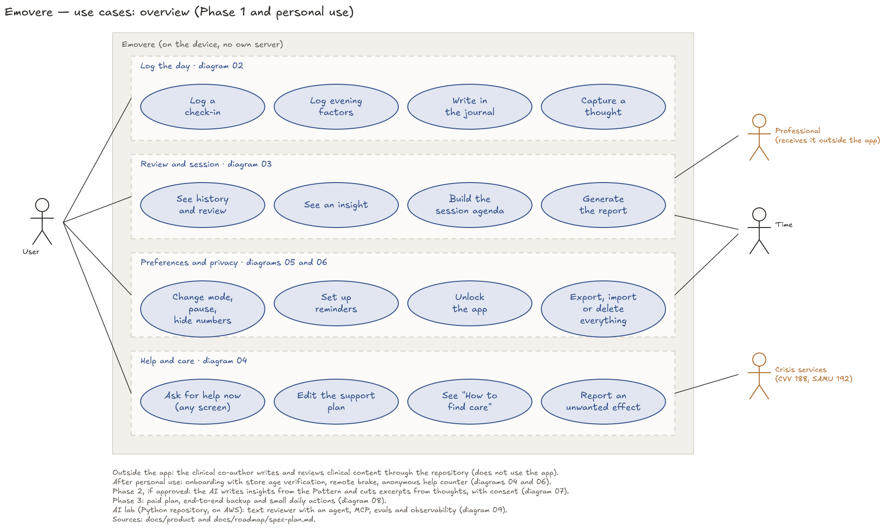
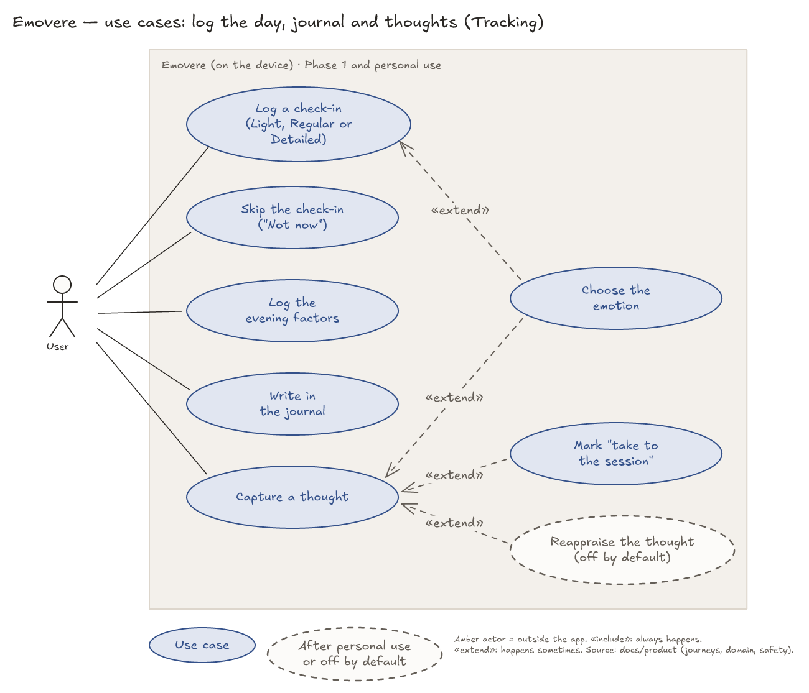
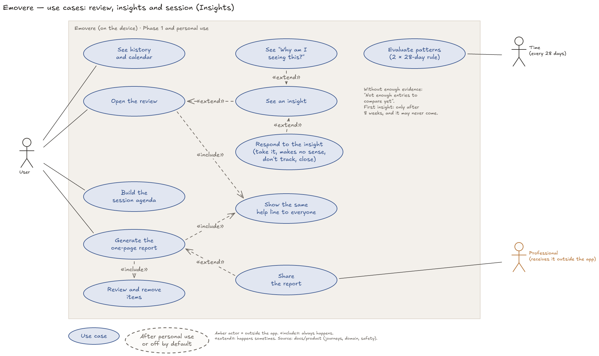
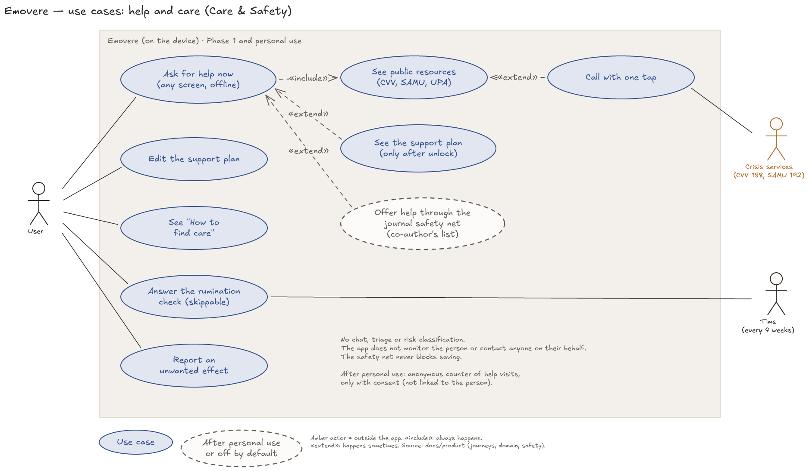
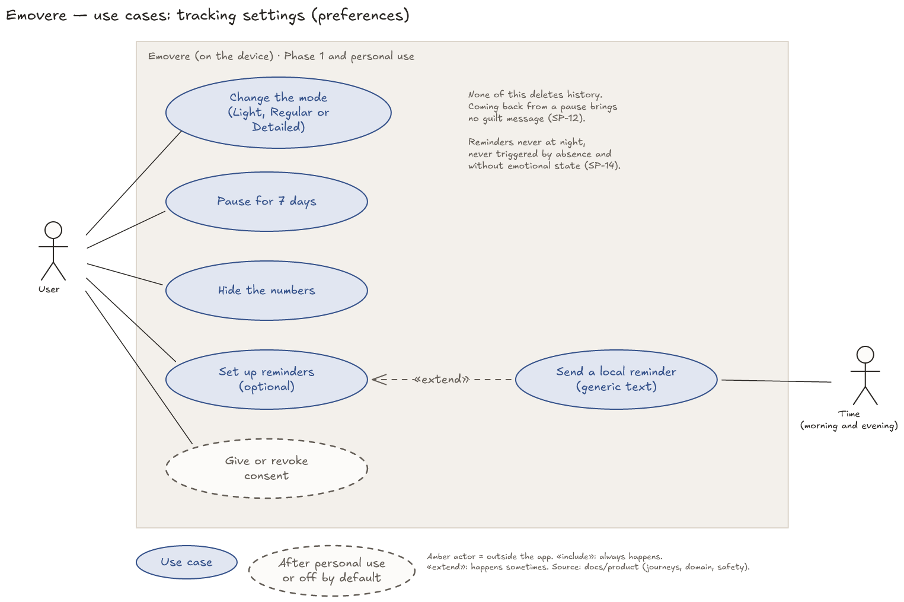
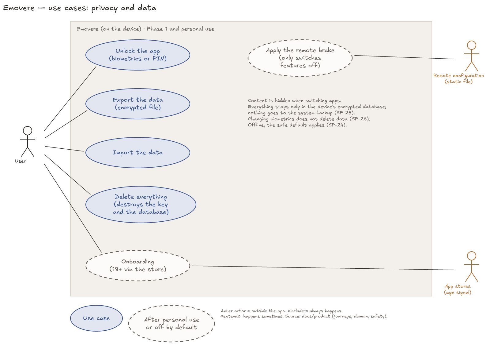
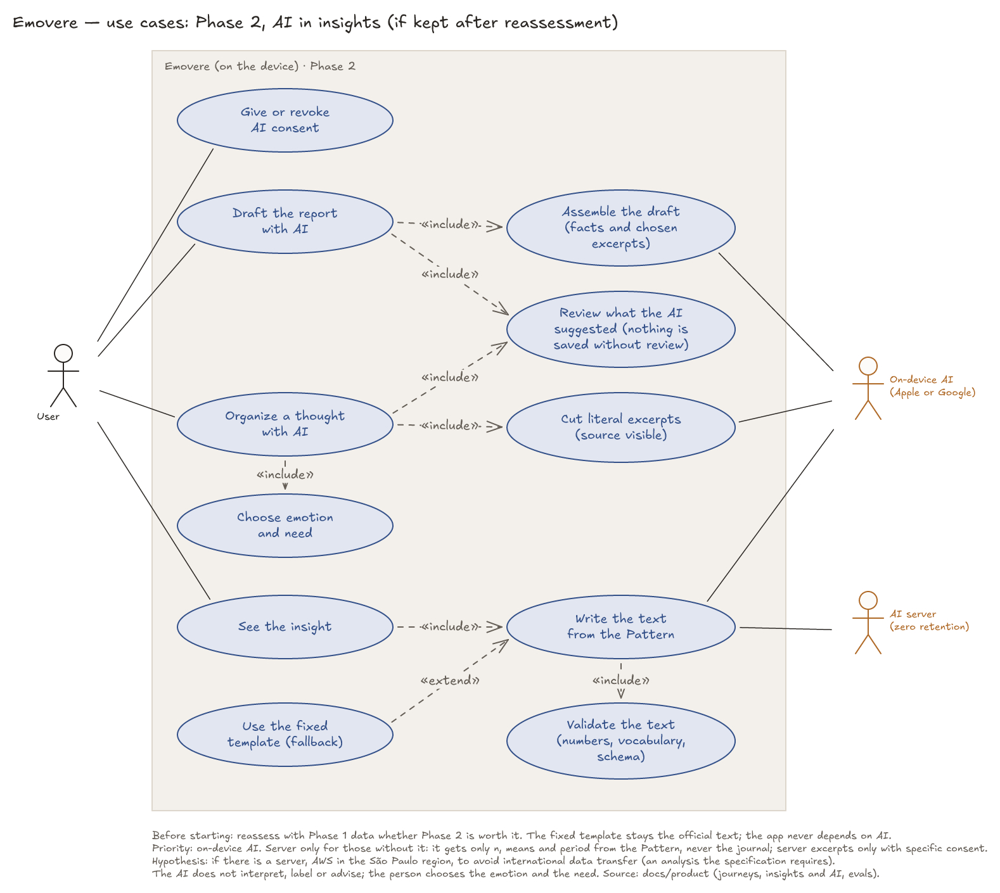
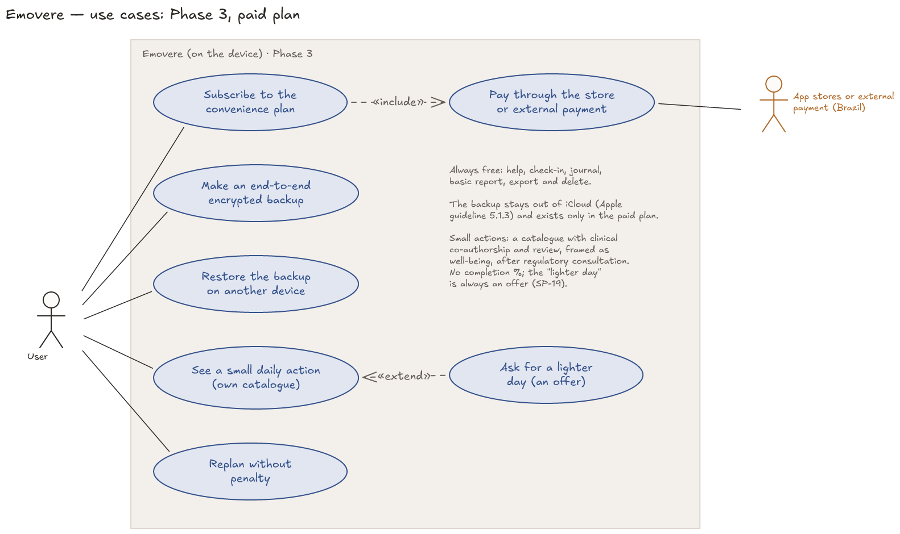
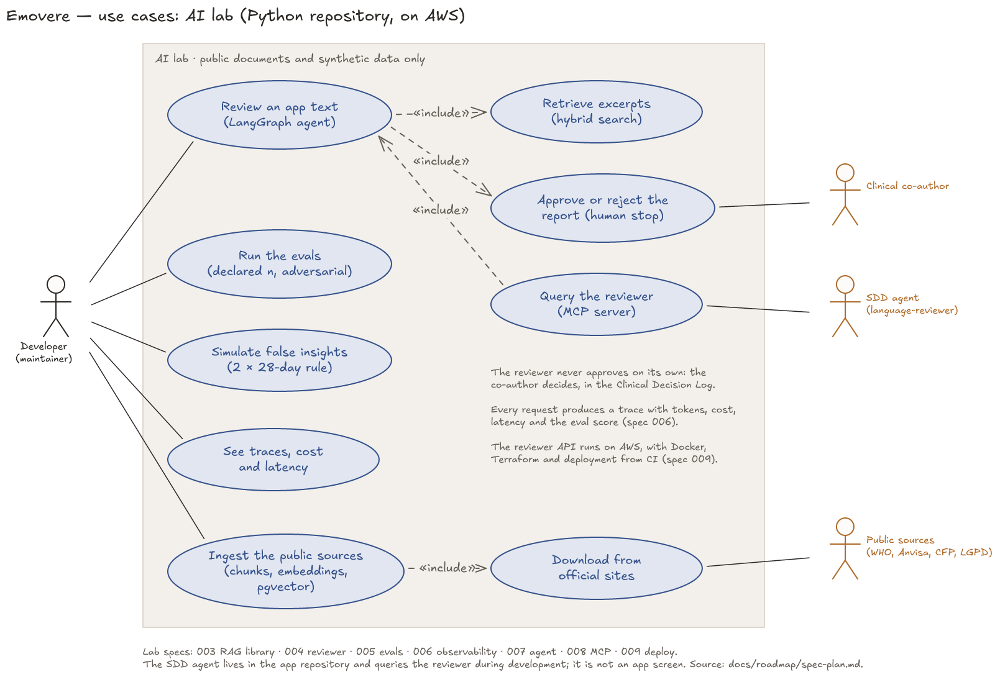

# Use-case diagrams

> Part of the Emovere product specification. Status: draft. Emovere is a self-knowledge journal that complements, and never replaces, professional care. It is not a medical device.

Nine diagrams: an overview, one per domain area in Phase 1, one for each later phase (2 and 3) and one for the AI lab. Each has a `.png` to view and an `.excalidraw` file to edit in [Excalidraw](https://excalidraw.com). Nothing here is a new decision: the use cases come from the journeys in [Personas and journeys](../product/03-personas-and-journeys.md) and from the criteria in [Clinical safety](../product/07-clinical-safety.md). The implementation order is in the [Spec plan](../roadmap/spec-plan.md).

**How to read them:** a blue ellipse is a Phase 1 use case; a dashed ellipse is a use case that comes after personal use or is off by default. An amber actor is outside the app. «include» always happens; «extend» happens sometimes.

## 1. Overview

## 2. Log the day, journal and thoughts (Tracking) — specs 007 to 010

## 3. Review, insights and session (Insights) — specs 011 to 014

## 4. Help and care (Care & Safety) — specs 004, 016, 019 and 020

## 5. Tracking settings — specs 015 and 017

## 6. Privacy and data — specs 003, 005 and 018; onboarding and the remote brake after personal use

## 7. Phase 2 — AI in the insights (if kept after the reassessment)

## 8. Phase 3 — paid plan

## 9. AI lab (Python repository, on AWS) — lab specs 003 to 009

## Modelling decisions

| Decision | Source | Reason |
|---|---|---|
| One diagram per domain area, plus the overview | [Architecture](../product/09-architecture.md) (modules) | Process |
| Settings and privacy split into two diagrams | Process | With everything together, the user's lines crossed the ellipses |
| "Time" as an actor (evaluation every 28 days, check every 4 weeks, reminders) | Journeys J1 and J3; SP-16 | Shows what the app does on its own, without action by the person |
| The professional appears as an external actor, only when the report is shared | Journey J3: the person generates the report, and there is no hosted link | The professional does not use the app |
| The help counter and hiding content when switching apps are notes, not ellipses | Journey J4; [Backlog](../product/17-backlog.md) | They are automatic effects, not actions by the person |
| The clinical co-author stays outside the diagrams and is mentioned in the overview note | [Constitution draft](../constitution-draft.md) (clinical owner) | The co-author maintains content through the repository, not through the app |
| Phase 2: "On-device AI" and "AI server" as external actors; the server is linked only to "Write the text", and the rule for excerpts on the server is in the note | [Phases](../product/05-phases.md) and [Insights and AI](../product/08-insights-and-ai.md) (the server receives only the `Pattern`; excerpts go to the server only with specific consent) | A dashed server → excerpt line crossed the on-device AI lines |
| AI lab: "Dev" as the main actor; the clinical co-author, the SDD agent (through MCP) and public sources as external actors; observability and AWS as a note | [Spec plan](../roadmap/spec-plan.md) (AI lab) | Tracing and deployment happen on every request; they are not someone's action |
| The AWS São Paulo region appears in the Phase 2 note as a hypothesis | [Phases](../product/05-phases.md) (international data transfer) | Not a decision: it only applies if Phase 2 has a server |
