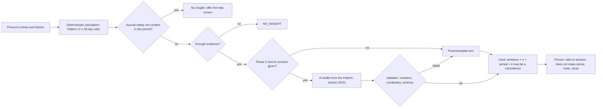

# Insights and AI

> Part of the Emovere product specification. Status: draft. Emovere is a self-knowledge journal that complements, and never replaces, professional care. It is not a medical device.

## What an insight is

An insight **describes the person's own entries**. It does not assess mental state, does not claim a cause, does not label, and never suggests an action based on the pattern.

| Allowed | Not allowed |
|---|---|
| "Nos 18 dias das últimas 8 semanas em que você marcou 'dormi mal', sua ansiedade ficou em 7, em média; nos outros 30 dias, em 5. Pode ser coincidência." ("On the 18 days of the last 8 weeks when you marked 'slept badly', your anxiety averaged 7; on the other 30 days, 5. It may be a coincidence.") | "Você apresenta sinais de ansiedade generalizada." ("You show signs of generalized anxiety.") (diagnosis) |
| "Nos dias em que você marcou 'trabalho pesado', seu humor ficou em 4, em média; nos outros, em 6 (últimas 8 semanas; 20 e 28 dias). Pode ser coincidência." ("On the days when you marked 'heavy workload', your mood averaged 4; on the others, 6 (last 8 weeks; 20 and 28 days). It may be a coincidence.") | "O trabalho está causando a sua tristeza." ("Work is causing your sadness.") (causality) |
| "Que tal levar isso para a sua próxima sessão?" ("How about taking this to your next session?") | "Seu humor piorou: procure ajuda." ("Your mood got worse: seek help.") (risk monitoring) |
| "Ainda não há registros suficientes para comparar." ("There are not enough entries yet to compare.") | "Vamos entender melhor por que você se sente assim?" ("Shall we understand better why you feel this way?") (pulls toward rumination) |

The numbers in the examples are illustrative.

## Factors (ADR-023)

- An insight compares days **with** and **without** a factor. Mood, anxiety and energy are the **outcomes**. Factors come from the evening log (J1) and, in Detailed mode, from hours of sleep.
- **Short, closed list**, defined with the clinical co-author. Examples under evaluation: sleep, physical activity, contact with people, context of the day.
- **At most 4 factor × outcome pairs** are tested (SP-07). More pairs only if the simulation stays below the limit (SP-22).
- **Forbidden as factors:** medication, food or weight, and substance use. An insight such as "nos dias em que tomou o remédio, sua ansiedade foi maior" ("on the days you took the medication, your anxiety was higher") could lead someone to stop a treatment (SP-20).
- Tags created by the person do not enter the engine.
- Pairs are only between a factor and an outcome: "low energy × low mood" relates a symptom to a symptom and is left out.

## Rule (ADR-022)

- **Two consecutive 28-day windows.** In each window, at least 6 days in each group (with and without the factor). The difference between the means must be at least 1.5 points (0–10) in both windows, in the same direction.
- **Evaluation every 28 days.** The first insight can appear on day 56 at the earliest, counted from the first check-in.
- **At most 2 insights per evaluation.** If more pairs pass the rule, a pair not yet shown comes first, then the largest difference.
- The n of each group and the period (the 8 weeks) are always shown. No p-value on screen; no cause.
- **`NO_INSIGHT` is a valid result:** "Ainda não há registros suficientes para comparar."
- **No symptom trajectory:** insights relate entries to each other. They never say that something "subiu" ("went up"), "piorou" ("got worse") or "melhorou" ("got better").
- **No repetition:** an insight that was taken to a session, disputed or muted does not come back for at least 56 days, unless there is a relevant change.
- **Fact** (simulation with synthetic data; see [`false-insight-simulation.py`](../research/false-insight-simulation.py)): over 24 weeks, with 4 pairs, an earlier candidate rule (2 × 14 days, evaluated every week) would show a false insight to 8.6%–21.3% of people with no real pattern, and 70%–74% of the insights shown would be true. This rule stays at 3.0%–4.2% and 93%–94%, and still finds more real patterns. The numbers are for comparing rules, not for promising rates.
- The simulation ([`false-insight-simulation.py`](../research/false-insight-simulation.py)) is ported to an automated test (SP-22): no rule change goes in if the rate goes over the limit.
- **Opinion:** with any safe rule, many small real patterns will never show up. This is a limit of single-person statistics. The product does not depend on insights: the initial value comes from quick logging, the history, the session agenda and the report.

## Calculation definitions (ADR-022)

- **Period shown:** the 8 weeks of the evaluation, together.
- **Alignment:** factor and outcome from the same day; hours of sleep from the previous night are matched with the following day.
- **A factor only counts if it varies:** present on 25% to 75% of the days in the period (proposal).
- **A day without an evening log is left out of the comparison:** only a "nada hoje" ("nothing today") log counts as a day without the factor. A missing log is not the same as the factor not happening.
- **Threshold for a continuous factor** (e.g., "less than 6 h of sleep"): set by the clinical co-author and **never adjusted automatically to "find" a pattern**.
- **To be decided (proposals):** two entries on the same day → daily average; an entry made up to 4 a.m. counts for the previous day.

## Biases no rule can fix

- Entries are missing more often on bad days; causation may run the other way (anxiety → poor sleep); weekdays and weekends are confounded with other factors.
- Therefore: the wording is always about association; "Por que estou vendo isso?" ("Why am I seeing this?") explains these limits; the card shows whether the pattern overlaps with weekdays or weekends; no insight suggests an action.

## Pipeline

## Allowed AI uses (Phase 2+, if kept)

1. Draft the text of an insight from a `Pattern` that has already been calculated. **For this, the model receives only the `Pattern` — never the journal text.** From the `Pattern`, only the n, the means and the period are sent; the days used stay on the device.
2. Extract verbatim excerpts from the journal for the thought record (extractive, with the source visible). **Preferably on the device;** on the server, only with specific consent.
3. Assemble the draft of the session report from calculated facts and excerpts chosen by the person.

## Forbidden AI uses

- Open chat, simulated therapy, diagnosis, prognosis, risk triage, trauma interpretation or medical advice.
- Inferring emotion, need, mental state, risk or behavior (e.g., "avoidance").
- Generating an insight from content caught by the journal safety net.
- Ranking, scoring or classifying the person.
- Free-form replies directly to the person about psychological distress.
- Using the journal or health data to train models without specific, informed and revocable consent.
- Persisting prompts, responses or embeddings with identifiable content in third-party tools.

## Technical contract (Phase 2)

- Structured output with a closed schema; IDs resolved in code.
- Deterministic validator: every number in the text exists in the `Pattern`; forbidden vocabulary (diagnoses, causal terms, imperatives, trajectory); length; language.
- Fallback to a fixed text template: **the app never depends on AI to work.**
- An `LLMProvider` port with two adapters: **on-device** (Apple Foundation Models on iOS 26+ on a compatible device, which supports Brazilian Portuguese, with typed output; Gemini Nano via ML Kit GenAI on compatible Android devices, with Portuguese support still to be confirmed) and **server** (receives only the `Pattern`, with zero retention). If no AI is available, the fixed template is used.
